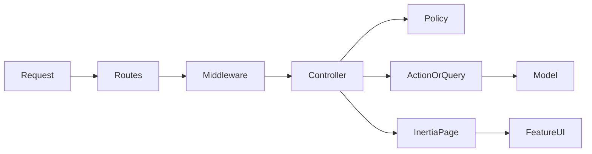

# Architecture

This application is a multi-tenant Laravel app with **folder-based domains** under `app/`. Cross-cutting wiring lives in the composition root — not inside domain service providers.

## Domains

| Domain | Responsibility |
|--------|----------------|
| **Accounts** | Users, Fortify hooks, profile, locale, security |
| **Audit** | Activity log model, audit permissions, tenant audit helpers |
| **ClientPortal** | Magic-link grants, portal middleware, guest session |
| **Clients** | Firm CRM clients |
| **DocumentProcessing** | OCR drivers, pipelines, related jobs/commands |
| **Dossiers** | Cases, document requests, uploads, exports, reminders |
| **Platform** | Support sessions, Inertia shared props, retention, readiness |
| **Questionnaires** | Reusable questionnaire templates |
| **Reporting** | Dashboards / activity / media UI over other domains’ models |
| **Shared** | Base controller, pagination helpers, shared DTOs |
| **Tenancy** | Tenants, memberships, invitations, permission infrastructure |
| **WorkspaceNotifications** | In-app notification inbox |
| **Providers** | App-level providers only (`AppServiceProvider`, Fortify, Health) |

`app/Providers/` is **not** a product domain — it is the application composition root alongside `bootstrap/`.

### Typical domain layout

A full feature domain (e.g. Dossiers) looks like:

```
app/{Domain}/
├── Actions/           # writes — one class per use case (*Action::handle)
├── Console/Commands/  # optional — register path in bootstrap/app.php
├── Data/              # readonly DTOs for Inertia props
├── Enums/             # status enums + *Permission implementing TenantPermission
├── Http/
│   ├── Controllers/
│   └── Requests/
├── Jobs/              # optional
├── Models/
├── Policies/          # AuthorizesTenantPermission
├── Queries/           # reads — Fetch*Query, existence helpers
└── Transitions/       # optional state machines
```

Thin domains (e.g. Reporting, WorkspaceNotifications) may only have `Http/`, `Queries/`, `Data/`, and sometimes `Actions/` — no models or policies when they reuse another domain’s models.

## Composition root

Domains stay plain PHP namespaces. The app wires them explicitly:

| Concern | Where |
|---------|-------|
| Routes | [`bootstrap/app.php`](../bootstrap/app.php) loads `routes/web.php`, then `health`, `tenant`, `portal` |
| Console commands | `withCommands([...])` paths under domain `Console/Commands` |
| Event listeners | Discovery: `app/*/Listeners` |
| Policies | `Gate::policy()` in [`AppServiceProvider`](../app/Providers/AppServiceProvider.php) |
| Morph map | `Relation::enforceMorphMap()` in `AppServiceProvider` |
| Permissions | Enums listed in [`config/tenant-permissions.php`](../config/tenant-permissions.php) |

Providers registered in [`bootstrap/providers.php`](../bootstrap/providers.php):

- `AppServiceProvider`
- `FortifyServiceProvider`
- `HealthServiceProvider`

There are **no** `*ServiceProvider` classes inside domain folders.

## HTTP audiences

```
routes/
├── web.php              # auth, session tenant; requires web/*
├── web/                 # reporting, tenancy/firms, platform, invitations
├── tenant.php           # workspace staff API/UI under workspaces/{tenant:slug}
├── tenant/              # clients, dossiers, members, questionnaires, …
├── portal.php           # guest client portal
├── settings.php
├── health.php
├── console.php
└── channels.php
```

**Tenant workspace stack** ([`routes/tenant.php`](../routes/tenant.php)):

1. `web`, `auth`, `verified`
2. `InitializeTenantFromRoute` — set current tenant from `{tenant:slug}` before model binding
3. `EnsureValidTenantMembership`
4. `SetPermissionTeamContext` — Spatie permission “team” = tenant
5. `NeedsTenant`

Domain route files only declare relative paths; the prefix and name (`workspaces.`) are applied once.

**Portal** uses its own middleware (`ResolveClientPortalGrant`, `HardenClientPortalResponse`) and does not use staff session tenancy the same way.

## Request flow



Controllers stay thin: authorize → call an Action or Query → return `Inertia::render()` (or a redirect/download).

### Backend patterns

- **Actions** — mutations and multi-step writes (`CreateDossierAction`, …)
- **Queries** — read models / index / show payloads (`FetchDossierIndexQuery`, …)
- **Data** — readonly DTOs shaped for the frontend
- **Transitions** — status rules (`DossierTransitions`, `DocumentRequestTransitions`)
- **BelongsToTenant** — tenant-scoped Eloquent models ([`app/Tenancy/Concerns/BelongsToTenant.php`](../app/Tenancy/Concerns/BelongsToTenant.php))
- **TenantContext** — `runForTenant()` for console jobs and async code when HTTP middleware did not set the tenant

Migrations and factories stay under `database/` — not inside `app/{Domain}`.

## Frontend

`resources/js` mirrors domains:

| Area | Role |
|------|------|
| `pages/` | Thin Inertia entry points — compose features |
| `features/<domain>/` | Domain UI + co-located `types.ts` |
| `components/` | Shared only (`ui/`, `app-shell/`, primitives) — never import from `features/` |
| `types/` | Cross-cutting types only (`auth`, `navigation`, `ui`) |
| `actions/`, `routes/` | Wayfinder-generated — do not edit |

Rough backend → frontend map:

| Backend | Pages / features |
|---------|------------------|
| Dossiers | `pages/dossiers`, `features/dossiers`, `features/document-requests` |
| Clients | `pages/clients`, `features/clients` |
| Questionnaires | `pages/questionnaires`, `features/questionnaires` |
| ClientPortal | `pages/portal`, `features/portal` (+ portal side of document-requests) |
| Tenancy | firms, onboarding, members, invitations |
| Reporting | dashboard / activity / media under workspaces |
| DocumentProcessing | pipelines under workspaces |
| Accounts | settings, auth, security |

Import boundaries and nesting rules are enforced by Biome — see [`.cursor/rules/frontend-architecture.mdc`](../.cursor/rules/frontend-architecture.mdc).

## Tests

Feature tests live under `tests/Feature/{Domain}/` (and related folders such as `Portal`). Prefer factories from `database/factories/`. Run the suite near your change with Sail + Pest.
