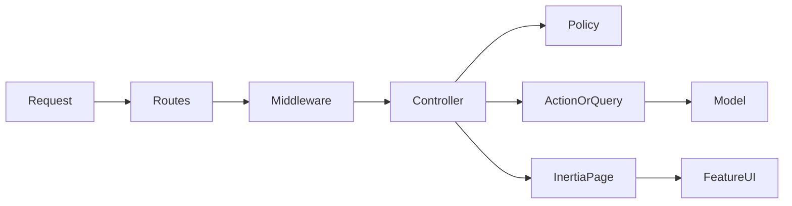

# Architecture

This application is a multi-tenant Laravel app with **folder-based domains** under `app/`. Cross-cutting defaults live in `AppServiceProvider`; domain bindings and policies live in each domain’s `*ServiceProvider`.

Convention guides: [Backend](backend.md) · [Frontend](frontend.md) · [Testing](testing.md)

## Domains

| Domain | Responsibility |
|--------|----------------|
| **Accounts** | Users, Fortify hooks, profile, locale, security |
| **AudioProcessing** | Audio transcription drivers, jobs, and configuration |
| **Audit** | Activity log model, audit permissions, tenant audit helpers |
| **ClientPortal** | Magic-link grants, portal middleware, guest session |
| **Clients** | Firm CRM clients |
| **DocumentProcessing** | OCR drivers, config, and related jobs/commands |
| **Dossiers** | Cases, document requests, uploads, exports, reminders |
| **Integrations** | Per-user OAuth connections (Microsoft first), Socialite drivers, encrypted tokens |
| **Pipelines** | Run tracking for long-running processes (OCR, transcription, export): model, retry, monitoring |
| **Platform** | Support sessions, Inertia shared props, retention, readiness |
| **Questionnaires** | Reusable questionnaire templates |
| **Reporting** | Dashboards / activity / media UI over other domains’ models |
| **Shared** | Base controller, pagination helpers, shared DTOs, cross-layer contracts |
| **Tenancy** | Tenants, memberships, invitations, permission infrastructure |
| **WorkspaceNotifications** | In-app notification inbox |
| **Providers** | App-level providers (`AppServiceProvider`, Fortify, Health) plus per-domain `*ServiceProvider` classes |

`app/Providers/` holds framework/app providers. Domain `*ServiceProvider` classes live next to their domain code under `app/{Domain}/`.

### Typical domain layout

Mixed domains are **layer-then-concern**: use-case code sits under `app/{Domain}/{Actions,Data,Queries,Http,…}/{Concern}/`. Mixed today: Dossiers, Accounts, ClientPortal, Tenancy, Platform, Reporting, Questionnaires, Integrations, DocumentProcessing. Models, Policies, and Enums stay at the domain root. Cross-feature plumbing stays in `Support/`; feature Support goes in `Support/{Concern}/`.

Thin domains stay flat (Clients, Pipelines, Audit, AudioProcessing, WorkspaceNotifications, Shared):

```
app/{Domain}/
├── Actions/           # writes — mixed domains: Actions/{Concern}/
├── Data/
├── Queries/
├── Http/
│   ├── Controllers/   # mixed domains: Controllers/{Concern}/
│   └── Requests/      # mixed domains: Requests/{Concern}/
├── Console/Commands/  # optional — register path in bootstrap/app.php
├── Enums/             # status enums + *Permission implementing TenantPermission
├── Jobs/              # optional
├── Models/
├── Policies/          # AuthorizesTenantPermission
├── Transitions/       # optional state machines
├── Support/           # optional — cross-feature plumbing; Support/{Concern}/ otherwise
└── {Domain}ServiceProvider.php  # policies + container bindings
```

Thin domains (e.g. WorkspaceNotifications) may only have `Http/`, `Queries/`, `Data/`, and sometimes `Actions/` — no models or policies when they reuse another domain’s models.

## Composition root

Domains are PHP namespaces with their own service providers for bindings and policies. The app registers them explicitly:

| Concern | Where |
|---------|-------|
| Routes | [`bootstrap/app.php`](../bootstrap/app.php) loads `routes/web.php`, then `health`, `tenant`, `portal` |
| Console commands | `withCommands([...])` paths under domain `Console/Commands` |
| Event listeners | Discovery: `app/*/Listeners` |
| Policies | `Gate::policy()` in the owning domain’s `*ServiceProvider` |
| Container bindings | Domain `*ServiceProvider::register()` (e.g. OCR/AWS in `DocumentProcessingServiceProvider`) |
| Morph map | `Relation::enforceMorphMap()` in [`AppServiceProvider`](../app/Providers/AppServiceProvider.php) |
| Permissions | Enums listed in [`config/tenant-permissions.php`](../config/tenant-permissions.php) |
| Pipeline runners | `PipelineRunnerRegistry::register()` in each owning domain's `*ServiceProvider::boot()` (OCR, AudioProcessing, Dossiers export) |

Providers registered in [`bootstrap/providers.php`](../bootstrap/providers.php):

- App-level: `AppServiceProvider`, `FortifyServiceProvider`, `HealthServiceProvider`
- Domain: `Platform`, `Integrations`, `Tenancy`, `Pipelines`, `DocumentProcessing`, `AudioProcessing`, `Dossiers`, `Audit`, `Clients`, `ClientPortal`, `Questionnaires`, `Reporting`

`AppServiceProvider` stays thin — defaults, factory discovery, morph map, and local tooling. Domain wiring (AWS/OCR, gates, policies) belongs in the matching domain provider.

## HTTP audiences

```
routes/
├── web.php              # auth, session tenant; requires web/*
├── web/                 # reporting, tenancy/firms, platform, invitations
├── tenant.php           # workspace staff API/UI under workspaces/{tenant:slug}
├── tenant/              # clients, dossiers, members, questionnaires, …
├── portal.php           # guest client portal
├── settings.php
├── health.php
├── console.php
└── channels.php
```

**Tenant workspace stack** ([`routes/tenant.php`](../routes/tenant.php)):

1. `web`, `auth`, `verified`
2. `InitializeTenantFromRoute` — set current tenant from `{tenant:slug}` before model binding
3. `EnsureValidTenantMembership`
4. `SetPermissionTeamContext` — Spatie permission “team” = tenant
5. `NeedsTenant`

Domain route files only declare relative paths; the prefix and name (`workspaces.`) are applied once.

**Portal** uses its own middleware (`ResolveClientPortalGrant`, `HardenClientPortalResponse`) and does not use staff session tenancy the same way.

## Request flow



Controllers stay thin: authorize → call an Action or Query → return `Inertia::render()` (or a redirect/download).

For detailed backend conventions (Actions, Queries, validation, models, persistence), see [Backend](backend.md).

### Backend patterns (summary)

- **Actions** — mutations and multi-step writes (`CreateDossierAction`, …)
- **Queries** — read models / index / show payloads (`FetchDossierIndexQuery`, …)
- **Data** — readonly DTOs shaped for the frontend
- **Transitions** — status rules (`DossierTransitions`, `DocumentRequestTransitions`, `UploadedDocumentProcessingTransitions`, `AudioTranscriptionTransitions`)
- **BelongsToTenant** — tenant-scoped Eloquent models ([`app/Tenancy/Concerns/BelongsToTenant.php`](../app/Tenancy/Concerns/BelongsToTenant.php)). Soft by default (no current tenant → empty results); workspace/portal opt into strict throw via `TenantContext`. Cross-tenant lookups use `queryWithoutTenantScope()`, not `withoutGlobalScopes()`.
- **TenantContext** — `runForTenant()` for console/async code; opt-in `enableStrict()` / `runStrict()` for fail-fast scoping (Octane-safe via Laravel Context)

### Async provider processing (OCR & transcription)

OCR and Amazon Transcribe follow the same shape: claim → start driver → complete or fail when the provider finishes (sync mock, or async SNS/EventBridge → SQS). Keep that narrative in the owning domain so call sites stay linear and scannable.

| Concern | Where | Why |
|---------|--------|-----|
| Status transitions (claim, complete, fail, retry reset) | Domain `Transitions/` | Same pattern as dossier exports / document requests; path- and job-id guards stay next to the model |
| Start + immediate audit | Domain orchestrators (`OcrOrchestrator`, `TranscriptionOrchestrator`) | Short linear methods — not Shared multi-callback runners |
| Terminal fail / complete from SQS | Domain `Actions/` (`Mark*`, `Complete*`, `Fail*`) | Domain-specific models, pipelines, and audit events |
| Driver selection | Domain `*DriverFactory` | Two drivers each; eager DI is enough |
| SQS long-poll + envelope parse | Domain `Console/Commands` | SNS (Textract) vs EventBridge (Transcribe) parsers differ; duplicate the small poll loop rather than a Shared Closure bag |

**Shared stays infrastructure-only** (pagination, CSP, tenant cache invalidation, …). Do not reintroduce Shared “async provider” façades that take five+ Closures for start/fail/claim. Prefer typed domain collaborators or deliberate duplication of tiny sequences when onboarding another provider.

`DocumentProcessing` and `AudioProcessing` may use `Pipelines` one-way for run tracking; Shared must not import either domain (enforced in [`tests/Pest.php`](../tests/Pest.php)).

### Domain layering

Domains are ordered; a domain may use domains below it and its own layer
siblings, never above. Enforced in [`tests/Pest.php`](../tests/Pest.php).

```
L0  Shared
L1  Accounts, Integrations
L2  Tenancy
L3  Questionnaires
L4  Clients, Dossiers, DocumentProcessing, AudioProcessing, Pipelines
L5  ClientPortal
L6  Reporting, Platform, WorkspaceNotifications
```

**Integrations** is an L1 sibling of Accounts: OAuth connections and Socialite
drivers. Login needs the token vault; calendar *product* UI stays higher and
calls Integrations rather than living inside it.

**Audit is cross-cutting**, not a layer: any domain may log activity, and Audit
itself may only reach Accounts and Tenancy.

Several pairs deliberately share a layer because the dependency really is
mutual — `Clients`/`Dossiers` (a dossier is a case *for* a client, and deleting
a client cascades), `Dossiers`/`DocumentProcessing` and `Dossiers`/`AudioProcessing`
(uploads and audio recordings carry OCR/transcription state that is part of
their lifecycle), and `Dossiers`/`Pipelines` (export runs are pipelines owned
by a dossier; `PipelinePolicy::download` also gates on `DossierPermission`).
`DocumentProcessing` and `AudioProcessing` each depend on `Pipelines` one-way
for run tracking, registering a `PipelineRunner` into its registry rather
than `Pipelines` knowing OCR/transcription specifics.

When a lower layer needs something from a higher one, invert it with a contract
the lower layer owns and the higher one binds — see
`Tenancy\Contracts\SupportSessionState`, `Dossiers\Contracts\ClientPortalReminders`,
`Pipelines\Contracts\PipelineRunner`, and `Shared\Cache\TenantCacheInvalidator`.

Migrations and factories stay under `database/` — not inside `app/{Domain}`.

## Frontend

`resources/js` mirrors domains. Pages are thin entry points; domain UI lives in `features/<domain>/`; shared pieces live in `components/` by role.

For directory layout, import rules, Wayfinder, forms, types, permissions UI, i18n, and Vitest, see [Frontend](frontend.md).

### Summary

| Area | Role |
|------|------|
| `pages/` | Thin Inertia entry points — compose features |
| `features/<domain>/` | Domain UI, domain hooks (`hooks/`), co-located `types.ts` |
| `components/` | Shared only, grouped by role — never imports from `features/` |
| `hooks/`, `lib/` | App-wide hooks and generic helpers only — nothing domain-aware |
| `layouts/` | One folder per audience (`app/`, `auth/`, `onboarding/`, `portal/`, `settings/`, `dossiers/`) |
| `types/` | Cross-cutting types (`auth`, `navigation`, `ui`, `pagination`) |
| `types/generated/` | Generated from PHP Data objects + enums — do not edit |
| `actions/`, `routes/` | Wayfinder-generated — do not edit |

`components/` sub-groups, bottom layer first:

| Group | Contents |
|-------|----------|
| `ui/` | shadcn primitives (vendored, lint-ignored) |
| `primitives/` | single-purpose, no composition (`heading`, `input-error`, `empty-state`, …) |
| `data/` | `data-table`, `index-list`, `index-query/`, `sortable/` |
| `forms/` | `file-dropzone`, `date-picker` |
| `feedback/` | `confirm-destroy-dialog` |
| `brand/` | brand panel, `ledger-field`, `audit-mark` |
| `app-shell/` | nav, sidebar, breadcrumbs |

**Payload types are generated.** Domain payload shapes come from the PHP `*Data`
objects (`php artisan typescript:transform`, part of `npm run types:check`), so
`features/<domain>/types.ts` is mostly aliases like
`export type Dossier = App.Dossiers.Data.Lifecycle.DossierShowData`. Add a field in the PHP
DTO, not in TypeScript; CI fails if the committed generated output is stale.

Rough backend → frontend map:

| Backend | Pages / features |
|---------|------------------|
| Dossiers | `pages/dossiers`, `features/dossiers`, `features/document-requests` |
| Clients | `pages/clients`, `features/clients` |
| Questionnaires | `pages/questionnaires`, `features/questionnaires` |
| ClientPortal | `pages/portal`, `features/portal` (shell) + `features/document-requests/portal` (renderers) |
| Tenancy | firms, onboarding, members, invitations |
| Reporting | dashboard / activity / media under workspaces |
| Pipelines | pipelines under workspaces (surfaced through Reporting's `PipelineController`) |
| DocumentProcessing | no dedicated UI — OCR runs surface via Pipelines |
| AudioProcessing | audio recordings, transcript UI |
| Accounts | settings, auth, security |

Import boundaries and nesting rules are enforced by Oxlint — see [`vite.lint.ts`](../vite.lint.ts) and [Frontend](frontend.md).

Questionnaire item types are defined once in PHP (`QuestionnaireItemType`), codegen'd to `features/document-requests/item-types/generated.ts`, and wired in staff (`questionnaire-item-type-registry.tsx`) and portal (`item-types/portal-registry.ts`) registries.

## Tests

Feature tests live under `tests/Feature/{Domain}/`. For Pest helpers, factories, assertions, and the Vitest split, see [Testing](testing.md).
