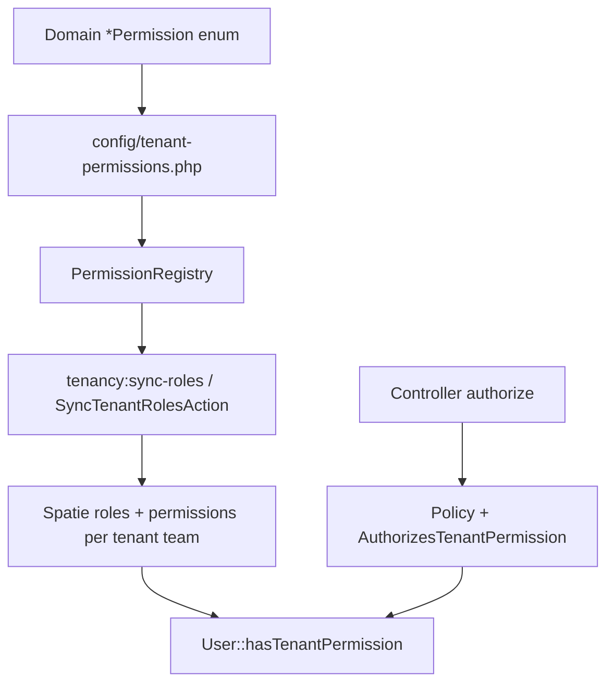

# Permissions

Tenant (firm) abilities are defined per domain, aggregated in one registry, synced into Spatie Permission roles, and checked in policies.

## Flow



1. **Domain owns** a string-backed enum implementing [`TenantPermission`](../app/Tenancy/Contracts/TenantPermission.php).
2. **Register** the enum class in [`config/tenant-permissions.php`](../config/tenant-permissions.php).
3. **[`PermissionRegistry`](../app/Tenancy/Support/PermissionRegistry.php)** loads every case (labels, groups, default roles). Resolved once per worker from config — safe under Octane.
4. **Persist** with [`SyncTenantRolesAction`](../app/Tenancy/Actions/SyncTenantRolesAction.php) via `tenancy:sync-roles`, tenant provision, or [`RolesAndPermissionsSeeder`](../database/seeders/RolesAndPermissionsSeeder.php).
5. **Policies** use [`AuthorizesTenantPermission`](../app/Tenancy/Policies/Concerns/AuthorizesTenantPermission.php); controllers call `$this->authorize(...)`.
6. **Spatie teams** equal the current tenant id (`SetPermissionTeamContext` on workspace routes). Platform support can overlay read-only access via `Gate::before` + support session.

## Contract

Each permission case must provide:

| Method | Purpose |
|--------|---------|
| `value` (backed enum) | Spatie permission name, e.g. `dossiers.view` |
| `label()` | UI label |
| `description()` | Short explanation for role screens |
| `group()` | [`PermissionGroup`](../app/Tenancy/Enums/PermissionGroup.php) for display |
| `defaultRoles()` | Roles that get this permission by default |

**Owner is implicit** — never list `Role::Owner` in `defaultRoles()`. Owners always receive every registered permission via `Role::grantsAllPermissions()`.

## Example: Dossiers

Enum ([`DossierPermission`](../app/Dossiers/Enums/DossierPermission.php)):

```php
enum DossierPermission: string implements TenantPermission
{
    case View = 'dossiers.view';
    case Create = 'dossiers.create';
    // ...

    public function group(): PermissionGroup
    {
        return PermissionGroup::Dossiers;
    }

    public function defaultRoles(): array
    {
        return match ($this) {
            self::View => [Role::Administrator, Role::Adviser, Role::Reviewer, Role::ReadOnly],
            self::Create, self::Update, /* ... */ => [Role::Administrator, Role::Adviser],
            // ...
        };
    }
}
```

Config registration:

```php
// config/tenant-permissions.php
'enums' => [
    DossierPermission::class,
    // ...
],
```

Policy ([`DossierPolicy`](../app/Dossiers/Policies/DossierPolicy.php)):

```php
final class DossierPolicy
{
    use AuthorizesTenantPermission;

    public function viewAny(User $user): bool
    {
        return $this->userHasPermissionInCurrentTenant($user, DossierPermission::View);
    }

    public function view(User $user, Dossier $dossier): bool
    {
        return $this->userHasPermissionInTenant(
            $user,
            $dossier->tenant,
            DossierPermission::View,
        );
    }
}
```

Use `userHasPermissionInCurrentTenant` for class-level gates (`viewAny`, `create`). Use `userHasPermissionInTenant` with the model’s tenant for instance gates. Policies may also encode business rules (e.g. completed dossiers cannot be updated).

## Roles

Default roles live in [`App\Tenancy\Enums\Role`](../app/Tenancy/Enums/Role.php) (Owner, Administrator, Adviser, Reviewer, ReadOnly). After changing enums or default role mappings:

```bash
vendor/bin/sail artisan tenancy:sync-roles
```

Use `--prune` only when you intend to delete Spatie permission rows that no longer exist in code.

## Adding permissions

| Change | What to do |
|--------|------------|
| New ability in an existing domain | Add a case to that domain’s `*Permission` enum |
| New domain’s first abilities | Create the enum, implement `TenantPermission`, add one line to `config/tenant-permissions.php` |
| New UI group | Add a case to `PermissionGroup` (label + `sortOrder`) |
| After any of the above | Run `tenancy:sync-roles` (and cover with feature tests) |

Adding a permission alone does not expose UI or routes — still wire policies, controllers, and frontend capability checks as needed.
