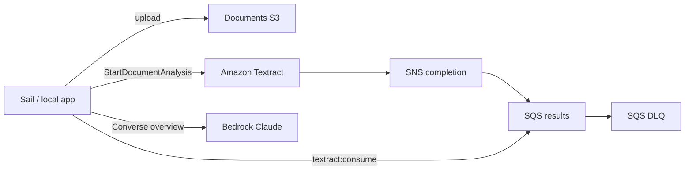

# Qompose OCR infrastructure (production only)

This Pulumi project provisions **only** the AWS pieces needed for local/Sail OCR:

- Private S3 documents bucket (KMS encrypted, versioned)
- Textract completion SNS topic → SQS results queue (+ DLQ)
- IAM role Textract assumes to publish SNS
- IAM user + access key for local Textract + Bedrock + S3/SQS (synced into `.env`)
- **ECS task role** carrying the same permissions, ready for when compute lands
- Optional DLQ email alarm

No VPC, ECS, ALB, RDS, Redis, or ECR.

The GitHub OIDC provider and the CI deploy roles live in a separate project —
see [`bootstrap/`](bootstrap/README.md).



## Deploy

```bash
cd apps/platform/infra
npm ci
pulumi login
pulumi stack select production   # or: pulumi stack init production
npm run preview
npm run up
pulumi stack output
```

`npm run preview` / `npm run up` compile TypeScript to `bin/` first. Pulumi runs the compiled JS (avoids ts-node `.js` import issues).
Optional alarm email:

```bash
pulumi config set alarmEmailAddress you@example.com
```

Confirm the SNS email subscription after the first deploy if you set that.

## Wire Sail / `.env`

After `pulumi up`, copy stack outputs into `apps/platform/.env`:

```bash
OCR_DRIVER=textract
FILESYSTEM_DISK=s3
AWS_DEFAULT_REGION=eu-west-1
AWS_BUCKET=<documentsBucketName>
TEXTRACT_SNS_TOPIC_ARN=<textractSnsTopicArn>
TEXTRACT_SNS_ROLE_ARN=<textractPublishRoleArn>
TEXTRACT_RESULTS_QUEUE_URL=<textractResultsQueueUrl>
OCR_BEDROCK_MODEL_ID=eu.anthropic.claude-sonnet-4-20250514-v1:0
```

### Sync OCR IAM credentials

This stack creates an IAM user + long-lived access key for **local development only**.

The reason is worth stating accurately, because it is easy to draw the wrong lesson
from it. IAM roles hand temporary credentials to something AWS already recognises —
an ECS task, an EC2 instance, a Lambda. A PHP process on your laptop is none of
those, so there is nothing to attach a role to. Until the stack grows compute, a
narrowly scoped IAM user is the honest option for local work.

The key is acceptable *because* the policy is narrow: one bucket, one queue, one KMS
key, and nothing else. It must never be how production runs — `src/application.ts`
already holds the identical permissions as an **ECS task role**, and the deployed
container will get credentials from the ECS agent instead, with no keys anywhere.
Both credential paths in the app skip explicit credentials when
`AWS_ACCESS_KEY_ID` / `AWS_SECRET_ACCESS_KEY` are empty, so that switch needs **no
application code changes** — just stop setting those two variables.

> An earlier version of this file said "root cannot assume roles." True, but beside
> the point: the fix is not using root at all. Enable IAM Identity Center, give
> yourself an admin user there, and `aws sso login` for short-lived credentials.

Sync the local key into `.env`:

```bash
cd apps/platform/infra
chmod +x scripts/sync-ocr-credentials.sh
./scripts/sync-ocr-credentials.sh
```

That sets `AWS_ACCESS_KEY_ID` / `AWS_SECRET_ACCESS_KEY`, clears `AWS_SESSION_TOKEN`, and clears MinIO endpoints.

```bash
vendor/bin/sail artisan config:clear
vendor/bin/sail artisan textract:consume
```

## Outputs

| Output | Purpose |
|--------|---------|
| `documentsBucketName` | S3 bucket for uploads |
| `textractSnsTopicArn` | Textract notification topic |
| `textractPublishRoleArn` | Role Textract assumes for SNS |
| `textractResultsQueueUrl` | Consumer queue URL |
| `textractResultsDeadLetterQueueUrl` | Failed messages |
| `ocrLocalUserName` | IAM user for local OCR |
| `ocrAccessKeyId` | Access key id (also via sync script) |
| `ocrSecretAccessKey` | Secret key (Pulumi secret; use sync script) |
| `ocrEncryptionKeyArn` | KMS key for bucket/queues |
| `appTaskRoleArn` | ECS task role — set as `taskRoleArn` on the task definition |

## Important

Running `pulumi up` against an existing full-platform production stack will **destroy** ECS, RDS, ALB, VPC, etc. that are no longer in this program. Preview carefully before applying.
