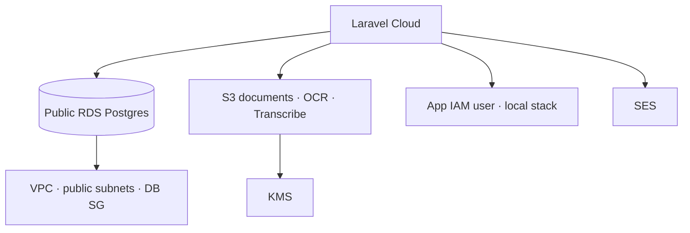

# Qompose platform infrastructure

One Pulumi program, one stack per environment. After TASK-43.3 it provisions the
**data plane only**: documents/OCR/Transcribe, public RDS, SES, and (on `local`)
the application IAM user. Application compute runs on Laravel Cloud.

```
src/
  shared/           components; the docker/base equivalent
  environments/     per-environment knobs, data only
  testing/          Pulumi mock harness for the stack tests
  index.ts          wires shared components with this stack's settings
```

The GitHub OIDC provider and the CI deploy roles live in a **separate** project —
see [`bootstrap/`](bootstrap/README.md). That separation is a security boundary, not
tidiness: the thing that grants CI its access must not itself be deployable by CI.

## Layout, and why it is shaped like `docker/`

`docker/` keeps one shared base image and a thin directory per environment. This
mirrors it. `src/shared/` builds every component; `src/environments/production.ts`,
`staging.ts`, and `local.ts` are pure data.

The rule that keeps it honest: **a component reads a knob from
`EnvironmentSettings`; it never branches on `environment.name`.** A name check
hides the difference inside the component, where nobody comparing two environments
will find it. The whole production/staging/local delta should be a settings-file diff.

| Knob | production | staging | local |
|---|---|---|---|
| `deletionProtection` | `true` | `false` | `false` |
| `databaseMultiAz` | `true` | `false` | `false` |
| `databaseBackupRetentionDays` | 14 | 3 | 1 |
| `databaseEnabled` | `true` | `true` | `true` |
| `databasePubliclyAccessible` | `true` | `true` | `true` |
| `dnsSubdomain` | `null` | `staging` | `local` |
| `crossRegionSnapshotCopy` | `true` | `false` | `false` |
| `monthlyBudgetUsd` | 200 | 75 | 25 |
| `applicationUserAccess` | `false` | `false` | `true` |

Every stack is documents/OCR plus public RDS for Laravel Cloud. `applicationUserAccess`
is the correctness constraint: exactly one environment mints the long-lived IAM
user + access key (decision-3), and `scripts/sync-ocr-credentials.sh` reads the
`local` stack. Floci remains the everyday local S3 path with mock OCR drivers.

## What the stack builds



Laravel Cloud runs the app. This stack owns the AWS data plane the app reaches
over the public internet: the documents bucket and OCR/Transcribe queues, a
public Postgres instance allowlisted to Cloud egress CIDRs, SES, and — on
`local` only — the IAM user whose keys Sail and Cloud share.

**Network.** Two public subnets, no NAT. The VPC exists only to host public RDS;
confinement is the database security group's Laravel Cloud egress allowlist, not
private subnets. Pulumi logical names (`vpc`, `igw`, `public-routes`, `public-0`,
`public-1`, `database-sg`, `db-subnets`) must stay byte-identical — a rename reads
as delete-then-create and would destroy the database.

**Database.** Public Postgres 17 with a static master password from Pulumi config
secret `databasePassword` (not Secrets Manager). Do not export the password as a
stack output.

**Malware scanning and audit.** GuardDuty Malware Protection scans every object
landing in the documents bucket and tags it with the verdict; the application reads
that tag at download and preview time and refuses anything not explicitly clean
(`docs/security.md`). CloudTrail data events record who read each object.

## Applying a stack

See [Deploy](#deploy). Set `databasePassword` as a Pulumi config secret on every
stack that enables RDS. Do not export it.

## Hostnames

Production serves `app.qompose.nl` with `*.qompose.nl` on the same certificate;
staging serves `app.staging.qompose.nl` and `*.staging.qompose.nl`. Separate levels,
so the two certificates can never claim the same names.

**The marketing site is safe by construction, not by careful ordering.** A DNS
wildcard only answers a name that has **no explicit record of its own**. `www` has
one; so does the apex, and so will `mail`, `api` or any other reserved host the
moment someone creates it. Publishing `*.qompose.nl` cannot capture them. This stack
simply never writes those names, and there is no carve-out list to maintain.

**Tenant hostnames are provisioned but not yet routed.** Tenancy resolves from the
path today (`/workspaces/{tenant:slug}`), and `config/production.php` restricts
`allowed_hosts` to the exact `APP_URL` host — so a `{slug}.qompose.nl` request
reaches the ALB and is refused by the application until **TASK-34.5** lands. Having
the certificate ready means that task is an application change, not a 45-minute
certificate-validation wait.

`hostedZoneId` is optional. Without it the stack still builds the certificate and the
load balancer and exports `dnsRecordsToCreate` for manual entry; it skips
`acm.CertificateValidation`, which would otherwise block every `pulumi up` waiting
for a record nobody is going to write.

## Deploy

Prerequisites, once per environment:

1. A deploy role from [`bootstrap/`](bootstrap/README.md). It defaults to production
   only — add staging with `pulumi config set --path environments[1] staging` there
   before deploying a staging stack.
2. A GitHub Environment named `production` / `staging` carrying `AWS_DEPLOY_ROLE_ARN`.

```bash
cd apps/platform/infra
npm ci
pulumi login
pulumi stack select production   # or: pulumi stack init staging

# Secrets are pasted, not generated: a value only Pulumi state holds is a value you
# lose with the stack — and losing APP_KEY means every encrypted column and signed
# URL becomes unreadable.
# Set these values in your shell or paste them directly without committing them.
pulumi config set --secret appKey "$APP_KEY"
pulumi config set --secret reverbAppId qompose
pulumi config set --secret reverbAppSecret "$REVERB_APP_SECRET"
pulumi config set --secret sentryDsn "$SENTRY_DSN"
pulumi config set --secret cacheAuthToken "$CACHE_AUTH_TOKEN"
# Only needed when edgeEnabled is true; the ALB refuses anything without it.
pulumi config set --secret originVerifySecret "$ORIGIN_VERIFY_SECRET"

# Plain, not a secret: this one is compiled into the JavaScript bundle and served
# to every visitor. Storing it encrypted would mean decrypting a value in order to
# produce a public asset. `reverbAppSecret` above is the one that authenticates.
pulumi config set reverbPublicKey "$REVERB_PUBLIC_KEY"

# Also plain, and also inlined into the bundle: the browser Sentry DSN. This is a
# DIFFERENT DSN from the secret below — that one is the Laravel project, this one
# is the JavaScript project. Required, not optional: config/services.php reads it
# server-side too, and the app refuses to boot with it empty.
pulumi config set sentryBrowserDsn "$SENTRY_BROWSER_DSN"

pulumi config set hostedZoneId "$HOSTED_ZONE_ID"    # optional, see Hostnames
pulumi config set alarmEmailAddress "$ALARM_EMAIL_ADDRESS"   # required for any alerting
pulumi config set alarmSmsNumber "$ALARM_SMS_NUMBER"         # optional, page-worthy only

npm run preview
npm run up
```

`imageTag` is not set by hand — the release workflow sets it to the commit SHA it
just pushed. Rolling back is `pulumi config set imageTag <older-sha>` and a deploy,
which is a true statement only because the ECR repository is tag-immutable.

`npm run preview` / `npm run up` compile TypeScript to `bin/` first (Pulumi runs the
compiled JS, which avoids ts-node `.js` import issues). Both scripts `rm -rf bin`
before compiling — without it, a renamed or deleted source file leaves stale
JavaScript behind that keeps running and keeps passing.

## Releasing

Three workflows, and the split is deliberate:

| Workflow | Does | AWS credentials |
|---|---|---|
| `platform.yml` | CI: tests, builds an OCI tarball, Trivy-scans it, uploads an artifact | none |
| `deploy.yml` | Infrastructure only — a knob change, a new alarm, a resize | deploy role |
| `release.yml` | Build -> push to ECR -> migrate -> roll the services | deploy role |

`release.yml` runs `pulumi up` three times, which looks redundant and is not:

1. **Ensure infrastructure exists.** The ECR repository lives in this stack, so it
   has to exist before anything can push to it. On a first release this also creates
   services pointing at a tag that is not in the registry yet — harmless and
   self-healing, because Pulumi's ECS Service does not wait for steady state, so the
   deploy succeeds while the tasks retry their pull. Every later release is a no-op
   diff here.
2. **Stage the migration image** — `--target` on the migrate task definition alone.
   This is the ordering that bites: a plain `pulumi up` would update every task
   definition and roll the services in one step, putting new code in front of an
   un-migrated schema. Targeting the migrate task first means migrations land before
   any new-code task takes a request.
3. **Roll the services**, now that the schema is ahead of them.

Between 2 and 3, `aws ecs run-task` runs the migration and the workflow checks the
container's exit code — a stopped task is not a successful one, and without that
check a failed migration is invisible and the rollout proceeds anyway.

The image build reads `VITE_REVERB_HOST`, `REVERB_PUBLIC_KEY` and
`VITE_SENTRY_DSN` from **stack outputs**, not from repository variables. Those
values are compiled into the JavaScript bundle and cannot be changed afterwards,
so an image built against the wrong ones runs perfectly and silently fails — no
WebSocket, or no browser error reporting. Reading them off the stack being
released to is what makes that mismatch impossible rather than merely unlikely.

`tests/Feature/Platform/ContainerImageLayoutTest.php` scans `resources/js` for
every `import.meta.env.VITE_*` and fails if one is not a build argument, because a
missing one is invisible until it is expensive.

## Local `.env` (`local` stack only)

Sail defaults to Floci + mock OCR drivers. For real Textract/Transcribe against AWS,
bring up the documents-only `local` stack, then sync credentials on the **host**
(not via Sail — Pulumi is not in the container):

```bash
cd apps/platform/infra && pulumi up -s local
cd apps/platform && composer env:aws     # or: cd infra && ./scripts/sync-ocr-credentials.sh
composer env:floci   # back to Sail's local AWS; env:aws re-applies the cached profile
```

That writes gitignored `env/profiles/aws.env` and upserts `FILESYSTEM_DISK=s3`,
`OCR_DRIVER=textract`, `TRANSCRIPTION_DRIVER=transcribe`, the IAM keys, the bucket
and the queue URLs into `.env`, clearing the Floci endpoints.

The `local` stack creates that IAM user and access key **for local development only**.
IAM roles hand temporary credentials to something AWS already recognises — an ECS
task, an EC2 instance, a Lambda. A PHP process on your laptop is none of those. The
key is acceptable *because* the policy is narrow: one bucket, the OCR queues, one KMS
key. It is never how production runs — the ECS task role carries the identical
managed policy and the container gets credentials from the ECS agent, with no keys
anywhere.

## What is monitored, and what to do about it

Everything that needs a human publishes to **one** SNS topic
(`pulumi stack output alertsTopicArn`) — deliberately one rather than one per
subsystem, because on-call needs a single place to subscribe and a topic per
concern is how an alarm ends up with no subscribers. Email always; SMS only if
`alarmSmsNumber` is set, and only worth setting for someone who will act on it.

Confirm the email subscription after the first deploy or nothing is delivered.

The set is deliberately small. Every alarm that fires without needing action
trains someone to ignore the next one, so this is not a dashboard: it is the set
where the answer to "what do I do about this" is never "nothing".

| Alarm | Means | First move |
|---|---|---|
| `alb-5xx-alarm` | The load balancer could not get a response from a healthy target — the app is down or unreachable, not merely erroring | `aws ecs describe-services` for `web`; check the deployment circuit breaker did not roll back onto a broken image |
| `web-unhealthy-alarm` / `reverb-unhealthy-alarm` | Tasks are failing `/ready` | Read the task's log group; `/ready` hits the database and Redis, so this is often really one of those |
| `database-events` (failover) | Multi-AZ failover happened and succeeded | Nothing urgent — the app survived it. Find out *why* AWS failed it over |
| `database-events` (low storage) / `database-storage-alarm` | Under 2 GiB free | Raise `databaseAllocatedStorageGb` and deploy. Postgres stops accepting writes when it fills |
| `worker-stopped-alarm` | No queue worker tasks running | Jobs are piling up silently in Redis; nothing errors. Check the worker service and its log group |
| `textract-dlq-alarm` / `transcribe-dlq-alarm` | Provider results failed processing five times | Inspect the DLQ, fix, then redrive. Documents are stuck in processing until you do |
| `transcribe-delivery-dlq-alarm` | EventBridge could not deliver to the results queue at all | Usually the queue policy or the KMS grant — a permissions problem, not a load one |
| `malware-findings` | GuardDuty found malware in an upload | The object is already inert: nothing will serve it, because the download gate refuses anything not tagged clean. Preserve it, tell the firm |
| Budget at 80% actual | The money is already spent | Check for a runaway scheduler or a queue retry loop |
| Budget at 100% forecast | This month's run rate has changed | Fires early enough to act — usually a service that scaled and never came back down |

**Acknowledging** is by fixing: alarms carry `okActions`, so the same topic gets a
recovery notification and no state is kept anywhere else. Nothing needs muting.
**Escalating** means adding a subscriber to that one topic.

### Disaster recovery

RDS automated backups are retained for 14 days in production and replicated
continuously to **eu-central-1**. That is the one deliberate exception to
eu-west-1 holding everything, and the reason is not incidental: an automated
backup lives in the same region as the instance it came from, so a regional
failure takes the database and its recovery point together. A copy in the same
region is a second copy of one failure domain, not disaster recovery.

eu-central-1 keeps the data inside the EU. `disasterRecoveryRegion` moves it;
`crossRegionSnapshotCopy: false` in the environment settings turns it off and
makes the stack single-region, which is what staging does. It costs storage and
nothing else — no standby instance, no Aurora.

Recovering means restoring the replicated backup into a new instance in the
destination region and repointing `DB_HOST`. This has **not been rehearsed**;
treat the recovery time as unmeasured until it has been.

## Tests

```bash
npm test              # builds, then node --test "bin/**/*.test.js"
```

`stack.production.test.ts` and `stack.staging.test.ts` run the whole program under
Pulumi's mock runtime and assert what it declared. They are **separate files on
purpose**: `pulumi.runtime.setMocks` is process-global and `index.js` is
module-cached, so two stacks in one process would silently share the first one's
resources. `node --test` forks per file, which is the only isolation available.

They exist to catch the failures that a successful `pulumi up` does not: ARM vs amd64,
the 60-second idle timeout, an 8080 ingress written as a CIDR, static AWS credentials
leaking into a task definition, and the `ProductionConfigurationValidator` keys that
would let the stack deploy green and then refuse every request.

## Outputs

| Output | Purpose |
|--------|---------|
| `appHostname` / `tenantHostnamePattern` | Hostnames this stack serves |
| `loadBalancerDnsName` / `certificateArn` | ALB target and its regional certificate |
| `edgeDomainName` / `edgeDistributionId` | CloudFront distribution; the domain works before DNS moves |
| `edgeCertificateArn` / `edgeWebAclArn` | us-east-1 certificate and the WAF ACL |
| `dnsRecordsToCreate` | Records to add by hand when `hostedZoneId` is unset |
| `containerRepositoryUrl` | ECR repository to push the image to |
| `reverbPublicKey` / `sentryBrowserDsn` | Baked into the JS bundle at image build time |
| `clusterName` / `migrateTaskDefinitionArn` | `aws ecs run-task` for migrations |
| `publicSubnetIds` / `taskSecurityGroupId` | Network placement for `run-task` |
| `databaseEndpoint` / `databaseMasterSecretArn` | Postgres host and RDS-managed secret |
| `cacheEndpoint` | Valkey primary endpoint |
| `applicationSecretArn` | Secrets Manager secret ECS resolves |
| `vpcId` / `platformEncryptionKeyArn` | Network and data-at-rest key |
| `alertsTopicArn` | The one topic every alarm publishes to |
| `documentsBucketName` | S3 bucket for uploads + Transcribe JSON output |
| `malwareProtectionPlanId` / `malwareFindingsRuleName` | GuardDuty scanning and its findings rule |
| `auditTrailName` / `auditLogBucketName` | CloudTrail data events for the documents bucket |
| `textractSnsTopicArn` / `textractPublishRoleArn` | Textract notification topic and its role |
| `textractResultsQueueUrl` (+ `…DeadLetterQueueUrl`) | Textract consumer queue |
| `transcribeResultsQueueUrl` (+ `…DeadLetterQueueUrl`) | Transcribe consumer queue |
| `transcribeDeliveryDeadLetterQueueUrl` | EventBridge FailedInvocations |
| `appTaskRoleArn` / `appExecutionRoleArn` / `appAccessPolicyArn` | ECS identities |
| `ocrLocalUserName` / `ocrAccessKeyId` / `ocrSecretAccessKey` | Local Sail credentials (`local` stack only) |
| `ocrEncryptionKeyArn` | KMS key for the documents bucket and queues |

## Important

`pulumi up` **destroys** any resource the program no longer declares. Read the
preview diff, especially after a refactor: a moved file that changes a logical
resource name reads to Pulumi as delete-then-create, and for the database that is not
a rename.

This platform is a fresh instance — nothing is migrated into it from an earlier
deployment, so the first `pulumi up` starts from an empty account rather than
converging on existing resources.
