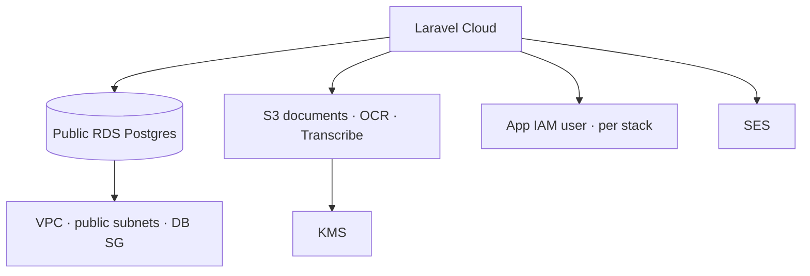

# Qompose platform infrastructure

One Pulumi program, one stack per environment. After TASK-43.3 it provisions the
**data plane only**: documents/OCR/Transcribe, SES, and (where enabled) public RDS.
The `local` stack is OCR/data-plane only — Sail uses Docker Postgres. Application
compute runs on Laravel Cloud.

```
src/
  shared/           reusable Pulumi components
  environments/     per-environment knobs, data only
  testing/          Pulumi mock harness for the stack tests
  index.ts          wires shared components with this stack's settings
```

The GitHub OIDC provider and the CI deploy roles live in a **separate** project —
see [`bootstrap/`](bootstrap/README.md). That separation is a security boundary, not
tidiness: the thing that grants CI its access must not itself be deployable by CI.

## Layout, and why it is shaped like `docker/`

`docker/` keeps one shared base image and a thin directory per environment. This
mirrors it. `src/shared/` builds every component; `src/environments/production.ts`,
`staging.ts`, and `local.ts` are pure data.

The rule that keeps it honest: **a component reads a knob from
`EnvironmentSettings`; it never branches on `environment.name`.** A name check
hides the difference inside the component, where nobody comparing two environments
will find it. The whole production/staging/local delta should be a settings-file diff.

| Knob | production | staging | local |
|---|---|---|---|
| `deletionProtection` | `true` | `false` | `false` |
| `databaseMultiAz` | `true` | `false` | `false` |
| `databaseBackupRetentionDays` | 14 | 3 | 1 |
| `databaseEnabled` | `true` | `true` | `false` |
| `databasePubliclyAccessible` | `true` | `true` | `false` |
| `dnsSubdomain` | `null` | `staging` | `local` |
| `crossRegionSnapshotCopy` | `true` | `false` | `false` |
| `monthlyBudgetUsd` | 200 | 75 | 25 |
| `applicationUserAccess` | `false` | `true` | `true` |

Production and staging are documents/OCR plus public RDS. `local` is OCR/data-plane
only — Sail uses Docker Postgres. `local` and `staging` each mint a scoped IAM
user for their **own** bucket and completion queues. Never point two runtimes at
the same `TEXTRACT_RESULTS_QUEUE_URL` — staging Cloud and local Sail would race
and delete each other's notifications. `composer env:aws` syncs the `local` stack;
`composer env:aws-staging` syncs staging outputs for reference. Floci remains the
everyday local S3 path with mock OCR drivers.

## What the stack builds



Laravel Cloud runs the app. This stack owns the AWS data plane the app reaches
over the public internet: the documents bucket and OCR/Transcribe queues, a
public Postgres instance allowlisted to Cloud egress CIDRs, SES, and — on stacks
with `applicationUserAccess` — the IAM user scoped to that stack's resources.

**Network.** Two public subnets, no NAT. The VPC exists only to host public RDS;
confinement is the database security group's Laravel Cloud egress allowlist, not
private subnets. Pulumi logical names (`vpc`, `igw`, `public-routes`, `public-0`,
`public-1`, `database-sg`, `db-subnets`) must stay byte-identical — a rename reads
as delete-then-create and would destroy the database.

**Database.** Public Postgres 17 with a static master password from Pulumi config
secret `databasePassword` (not Secrets Manager). Do not export the password as a
stack output.

**Malware scanning and audit.** GuardDuty Malware Protection scans every object
landing in the documents bucket and tags it with the verdict; the application reads
that tag at download and preview time and refuses anything not explicitly clean
(`docs/security.md`). CloudTrail data events record who read each object.

## Applying a stack

See [Deploy](#deploy). Set `databasePassword` as a Pulumi config secret on every
stack that enables RDS. Do not export it.

## Hostnames

Production serves `app.qompose.nl` with `*.qompose.nl` on the same certificate;
staging serves `app.staging.qompose.nl` and `*.staging.qompose.nl`. Separate levels,
so the two certificates can never claim the same names.

**The marketing site is safe by construction, not by careful ordering.** A DNS
wildcard only answers a name that has **no explicit record of its own**. `www` has
one; so does the apex, and so will `mail`, `api` or any other reserved host the
moment someone creates it. Publishing `*.qompose.nl` cannot capture them. This stack
simply never writes those names, and there is no carve-out list to maintain.

**Tenant hostnames are provisioned but not yet routed.** Tenancy resolves from the
path today (`/workspaces/{tenant:slug}`), and `config/production.php` restricts
`allowed_hosts` to the exact `APP_URL` host — so a `{slug}.qompose.nl` request
reaches Laravel Cloud and is refused by the application until **TASK-34.5** lands.
Having the certificate ready means that task is an application change, not a
certificate-validation wait.

`hostedZoneId` is optional. Without it the stack still builds SES and exports
`dnsRecordsToCreate` for manual entry.

## Deploy

Prerequisites, once per environment:

1. A deploy role from [`bootstrap/`](bootstrap/README.md). It defaults to production
   only — add staging with `pulumi config set --path environments[1] staging` there
   before deploying a staging stack.
2. A GitHub Environment named `production` / `staging` carrying `AWS_DEPLOY_ROLE_ARN`
   and `DATABASE_PASSWORD`.

```bash
cd apps/platform/infra
npm ci
pulumi login
pulumi stack select production   # or: pulumi stack init staging

pulumi config set aws:region eu-west-1
pulumi config set --secret databasePassword "$DATABASE_PASSWORD"

pulumi config set hostedZoneId "$HOSTED_ZONE_ID"    # optional, see Hostnames
pulumi config set alarmEmailAddress "$ALARM_EMAIL_ADDRESS"   # required for any alerting
pulumi config set alarmSmsNumber "$ALARM_SMS_NUMBER"         # optional, page-worthy only

npm run preview
npm run up
```

Application secrets (`APP_KEY`, Reverb, Sentry, etc.) live in **Laravel Cloud**,
not in this stack.

`npm run preview` / `npm run up` compile TypeScript to `bin/` first (Pulumi runs the
compiled JS, which avoids ts-node `.js` import issues). Both scripts `rm -rf bin`
before compiling — without it, a renamed or deleted source file leaves stale
JavaScript behind that keeps running and keeps passing.

## Releasing

Two workflows, and the split is deliberate:

| Workflow | Does | AWS credentials |
|---|---|---|
| `platform.yml` | CI: tests, quality, migrations | none |
| `deploy.yml` | Data-plane Pulumi only — RDS, documents/OCR, SES, alarms | deploy role |

Application code deploys via **Laravel Cloud push-to-deploy** when `staging` or
`main` is pushed. Rollback is redeploying an older commit in Cloud — not setting
an `imageTag`.

Infra deploys manually via `deploy.yml` (workflow dispatch). Each GitHub
Environment (`staging`, `production`) must have `DATABASE_PASSWORD` configured;
the workflow writes it to Pulumi config secret `databasePassword`. One-time CLI
alternative:

```bash
cd apps/platform/infra
pulumi config set --secret databasePassword '…' --stack staging
```

The workflow removes obsolete compute-era config keys (`imageTag`, `appKey`,
Reverb/Sentry/cache secrets) on each run.

## Local `.env` (`local` stack)

Sail defaults to Floci + mock OCR drivers. For real Textract/Transcribe against the
**local** data plane, bring up the `local` stack and sync credentials on the
**host** (not via Sail — Pulumi is not in the container):

```bash
cd apps/platform/infra && pulumi up -s local
cd apps/platform && composer env:aws     # writes aws-local.env + aws.env
composer env:floci   # back to Sail's local AWS; env:aws re-applies the cached profile
```

That writes gitignored `env/profiles/aws-local.env` and upserts `FILESYSTEM_DISK=s3`,
`OCR_DRIVER=textract`, `TRANSCRIPTION_DRIVER=transcribe`, the IAM keys, the bucket
and the queue URLs into `.env`, clearing the Floci endpoints.

## Laravel Cloud staging ( `staging` stack )

Staging uses a **separate** bucket, SNS topic, and SQS queues (`qompose-staging-*`).
After `pulumi up -s staging`, copy stack outputs into Laravel Cloud environment
variables — at minimum `AWS_*`, `TEXTRACT_*`, and `TRANSCRIBE_RESULTS_QUEUE_URL` from:

```bash
cd apps/platform/infra
pulumi stack output --stack staging
# or preview locally:
PULUMI_STACK=staging ./scripts/sync-ocr-credentials.sh   # writes env/profiles/aws-staging.env
```

**Do not** reuse the local stack queue URLs on Cloud staging; that races with Sail
and drops completions silently.

Each stack mints its own IAM user when `applicationUserAccess` is true. The key is
acceptable *because* the policy is narrow — one bucket, that stack's OCR and
Transcribe queues, Bedrock, one KMS key, plus SES send attached separately.
**Rotation is the whole mitigation** — see below. Recorded as decision-10 (partially
superseded: local and staging no longer share one key/queue).

### Rotating the application access key

Two copies exist — Pulumi state for the `local` stack, and Laravel Cloud's secret
store for the deployed environments. **Rotating one and not the other leaves the app
running on a credential you believe is revoked**, so the order below creates the new
key before destroying the old one and never leaves a gap.

1. **Mint a replacement alongside the current key.** An IAM user may hold two access
   keys at once, which is what makes a zero-downtime rotation possible. The user is
   `qompose-local-ocr-local` (`environment.resourceName("ocr-local")` on the `local`
   stack) — confirm with `pulumi stack output` rather than trusting this file if the
   stack has been renamed:
   ```bash
   aws iam create-access-key --user-name qompose-local-ocr-local
   ```
2. **Update Laravel Cloud first**, because it is the copy that serves traffic. Set
   `AWS_ACCESS_KEY_ID` and `AWS_SECRET_ACCESS_KEY` in the environment's variables and
   redeploy. Confirm with `GET /ready` — it exercises S3 in the same probe, so a
   broken credential fails it rather than surfacing later on an upload.
3. **Update local development**: re-run `./scripts/sync-ocr-credentials.sh` if the key
   is still Pulumi-managed, or edit `env/profiles/aws.env` and re-apply with
   `composer env:aws`.
4. **Verify the old key is idle before deleting it.** `LastUsedDate` is the only
   evidence that nothing still holds it:
   ```bash
   aws iam get-access-key-last-used --access-key-id <OLD_KEY_ID>
   ```
5. **Deactivate, wait, then delete.** Deactivating is reversible; deleting is not, so
   leave a window long enough to notice a missed consumer:
   ```bash
   aws iam update-access-key --user-name qompose-local-ocr-local \
     --access-key-id <OLD_KEY_ID> --status Inactive
   # confirm nothing broke, then:
   aws iam delete-access-key --user-name qompose-local-ocr-local --access-key-id <OLD_KEY_ID>
   ```

Rotate on a schedule, and immediately if a laptop holding `env/profiles/aws.env` is
lost or a key reaches a log, a screenshot or a shell history that leaves the machine.

## What is monitored, and what to do about it

Everything that needs a human publishes to **one** SNS topic
(`pulumi stack output alertsTopicArn`) — deliberately one rather than one per
subsystem, because on-call needs a single place to subscribe and a topic per
concern is how an alarm ends up with no subscribers. Email always; SMS only if
`alarmSmsNumber` is set, and only worth setting for someone who will act on it.

Confirm the email subscription after the first deploy or nothing is delivered.

The set is deliberately small. Every alarm that fires without needing action
trains someone to ignore the next one, so this is not a dashboard: it is the set
where the answer to "what do I do about this" is never "nothing".

| Alarm | Means | First move |
|---|---|---|
| `database-events` (failover) | Multi-AZ failover happened and succeeded | Nothing urgent — the app survived it. Find out *why* AWS failed it over |
| `database-events` (low storage) / `database-storage-alarm` | Under 2 GiB free | Raise `databaseAllocatedStorageGb` and deploy. Postgres stops accepting writes when it fills |
| `textract-dlq-alarm` / `transcribe-dlq-alarm` | Provider results failed processing five times | Inspect the DLQ, fix, then redrive. Documents are stuck in processing until you do |
| `transcribe-delivery-dlq-alarm` | EventBridge could not deliver to the results queue at all | Usually the queue policy or the KMS grant — a permissions problem, not a load one |
| `malware-findings` | GuardDuty found malware in an upload | The object is already inert: nothing will serve it, because the download gate refuses anything not tagged clean. Preserve it, tell the firm |
| Budget at 80% actual | The money is already spent | Check for a runaway scheduler or a queue retry loop |
| Budget at 100% forecast | This month's run rate has changed | Fires early enough to act — usually a service that scaled and never came back down |

**Acknowledging** is by fixing: alarms carry `okActions`, so the same topic gets a
recovery notification and no state is kept anywhere else. Nothing needs muting.
**Escalating** means adding a subscriber to that one topic.

### Disaster recovery

RDS automated backups are retained for 14 days in production and replicated
continuously to **eu-central-1**. That is the one deliberate exception to
eu-west-1 holding everything, and the reason is not incidental: an automated
backup lives in the same region as the instance it came from, so a regional
failure takes the database and its recovery point together. A copy in the same
region is a second copy of one failure domain, not disaster recovery.

eu-central-1 keeps the data inside the EU. `disasterRecoveryRegion` moves it;
`crossRegionSnapshotCopy: false` in the environment settings turns it off and
makes the stack single-region, which is what staging does. It costs storage and
nothing else — no standby instance, no Aurora.

Recovering means restoring the replicated backup into a new instance in the
destination region and repointing `DB_HOST`. This has **not been rehearsed**;
treat the recovery time as unmeasured until it has been.

## Tests

```bash
npm test              # builds, then node --test "bin/**/*.test.js"
```

`stack.production.test.ts` and `stack.staging.test.ts` run the whole program under
Pulumi's mock runtime and assert what it declared. They are **separate files on
purpose**: `pulumi.runtime.setMocks` is process-global and `index.js` is
module-cached, so two stacks in one process would silently share the first one's
resources. `node --test` forks per file, which is the only isolation available.

They exist to catch the failures that a successful `pulumi up` does not: ARM vs amd64,
the 60-second idle timeout, an 8080 ingress written as a CIDR, static AWS credentials
leaking into a task definition, and the `ProductionConfigurationValidator` keys that
would let the stack deploy green and then refuse every request.

## Outputs

| Output | Purpose |
|--------|---------|
| `appHostname` / `tenantHostnamePattern` | Hostnames this stack serves (CORS / docs) |
| `uploadAllowedOrigins` (Pulumi config, optional) | Extra browser origins for presigned PUT uploads |
| `dnsRecordsToCreate` | Records to add by hand when `hostedZoneId` is unset |
| `documentsBucketName` | S3 bucket for uploads + Transcribe JSON output |
| `textractSnsTopicArn` / `textractPublishRoleArn` | Textract notification topic and its role |
| `textractResultsQueueUrl` (+ `…DeadLetterQueueUrl`) | Textract consumer queue |
| `transcribeResultsQueueUrl` (+ `…DeadLetterQueueUrl`) | Transcribe consumer queue |
| `transcribeDeliveryDeadLetterQueueUrl` | EventBridge FailedInvocations |
| `malwareProtectionPlanId` / `malwareFindingsRuleName` | GuardDuty scanning and its findings rule |
| `auditTrailName` / `auditLogBucketName` | CloudTrail data events for the documents bucket |
| `alertsTopicArn` | The one topic every alarm publishes to |
| `appAccessPolicyArn` | Managed policy for the Laravel Cloud / local IAM user |
| `ocrLocalUserName` / `ocrAccessKeyId` / `ocrSecretAccessKey` | Local Sail credentials (`local` stack only) |
| `ocrEncryptionKeyArn` / `platformEncryptionKeyArn` | KMS keys for documents and RDS |
| `vpcId` | VPC hosting public RDS |
| `databaseEndpoint` / `databasePort` / `databaseName` / `databaseUsername` | Postgres connection (password in Pulumi config secret `databasePassword`, not exported) |
| `mailDomain` | SES domain identity |

## Important

`pulumi up` **destroys** any resource the program no longer declares. Read the
preview diff, especially after a refactor: a moved file that changes a logical
resource name reads to Pulumi as delete-then-create, and for the database that is not
a rename.

This platform is a fresh instance — nothing is migrated into it from an earlier
deployment, so the first `pulumi up` starts from an empty account rather than
converging on existing resources.
